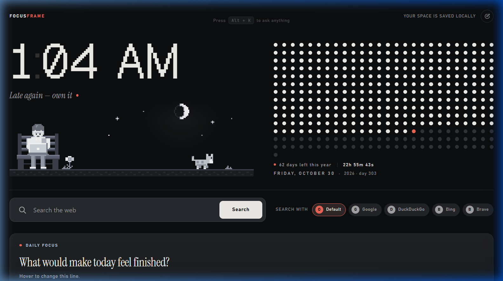
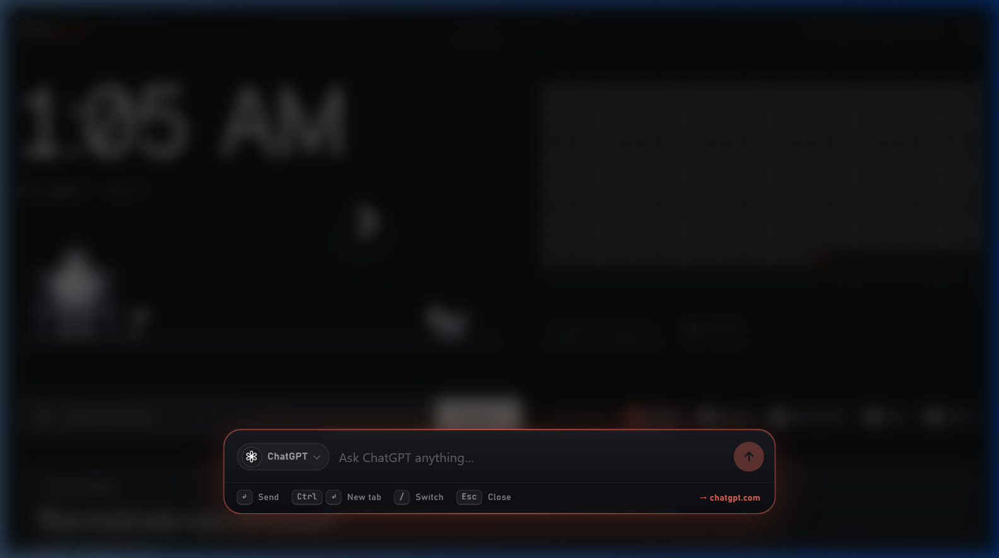

<div align="center">


**A calm, pixel-art new tab for people who want their first screen of the day to say what matters.**

One daily focus · three tasks · a handful of habits · your links · all on your device.

[](https://github.com/vikasaurous/FocusFrame/actions)
[](https://developer.chrome.com/docs/extensions/mv3/intro/)
[](https://nodejs.org/)
[](https://github.com/vikasaurous/FocusFrame#development)
[](https://github.com/vikasaurous/FocusFrame#privacy)
[](https://github.com/vikasaurous/FocusFrame#privacy)
[](https://github.com/vikasaurous/FocusFrame#install)

[](docs/screenshots/hero.png)

</div>

---

## Why FocusFrame?

Most new tab pages are a wall of widgets. FocusFrame is the opposite: a few things that help you start your day, and a small pixel scene that keeps you company while you work.

- **Write one intention.** A single focus line so you don't forget what today is for.
- **Three tasks, not thirty.** A hard limit keeps the list honest.
- **Habits that reset by the calendar.** Weekly view with streaks, no guilt.
- **Everything stays on your device.** No account, no sync service, no analytics.

---

## Features

### 🖼 Pixel scene

A hand-drawn pixel scene sits at the top of every new tab: a person coding on a bench, a pet at their side, flowers, and a sky that tracks your actual local time.

- Sun by day, moon and stars at night — both cross the sky as the hours pass.
- Animated sun rays and a walking pet (frame-by-frame pixel animation).
- Choose your pet: **cat**, **dog**, or **dino**.
- Hover the person or the pet for a reaction.
- Respects `prefers-reduced-motion` — nothing moves on its own when reduced motion is on.
- Can be turned off entirely from the customize panel.

### 🃏 Cards

| Card | What it does |
|------|-------------|
| **Daily Focus** | One line for today, plus an optional short note. Hover to edit. |
| **Top 3 Tasks** | Up to three tasks. Finished ones clear overnight; unfinished ones carry over. |
| **Habits** | Up to five named habits, Monday–Sunday. Streaks, weekly count, late check-ins for earlier days in the current week. Future days are locked. |
| **Quick Links** | Shortcuts to your favourite sites. Add and reorder them in the customize panel. |
| **Now** | A short note about what you are doing right now. |
| **Quote** | A daily quote. Shuffle, pin one, or write your own. |
| **Countdown** | Days remaining to an exam, launch, or trip. |

New installs show **Daily Focus**, **Top 3 Tasks**, **Quick Links**, and **Habits**. The remaining cards are one click away in the customize panel.

### 📐 Drag-and-drop layout

- Drag any card by its **DRAG** handle (visible on hover).
- Drop on the **left or right half** of a card to place it beside it.
- Drop on the **top or bottom edge** to start a new row.
- A row holds **up to three cards** — one is full-width, two share it equally, three take a third each.
- Dropping onto a full row from another row **swaps** the two cards.
- Cards restyle themselves to their width and wrap on narrow windows.

### 🔍 Search and command bar

- Built-in search box — choose your engine: browser default, Google, DuckDuckGo, Bing, or Brave.
- Press **Alt + K** (configurable) to open the command bar.
- Type a `/command query` to jump anywhere: `/wiki cats`, `/r python`, `/gh react`.
- 16 built-in destinations: Wikipedia, Reddit, GitHub, Stack Overflow, Google Maps, Google Images, Google Translate, Spotify, Amazon, ChatGPT, Claude, Gemini, Perplexity, Grok, Google, and YouTube.
- Customize: default destination, same-tab or new-tab results, on/off toggle, and shortcut key.



### 📅 Year in dots

A 365-dot calendar in the page header shows how far through the year you are, with days remaining and a live countdown to midnight. An optional animated snake can eat through the finished days (off by default; speed and regrow cycle are adjustable).

### 🎨 Customize panel

- Show or hide any card.
- Four accent colors: **coral**, **cobalt**, **moss**, and **plum**.
- Scene, pet, and year-snake settings.
- **Reset to starter layout** restores defaults in one click.
- Keyboard accessible — visible focus states and labelled controls throughout.

---

## Install

> **Store status:** FocusFrame has not been submitted to the Chrome Web Store or any other browser store yet. The installation below is the only way to run it.

### Manual (unpacked) install

1. **Download the repository.**

   ```bash
   git clone https://github.com/vikasaurous/FocusFrame.git
   ```

   Or click **Code → Download ZIP** and unzip it.

2. **Open your browser's extension page.**

   | Browser | Address |
   |---------|---------|
   | Chrome | `chrome://extensions` |
   | Edge | `edge://extensions` |
   | Brave | `brave://extensions` |

3. Enable **Developer mode** (toggle in the top-right corner).
4. Click **Load unpacked** and select the folder that contains `manifest.json`.
5. Open a new tab.

**Notes**

- Chrome may show a reminder about developer-mode extensions at startup — this is normal for unpacked installs.
- Since Chrome 138, Chrome adds its own footer on extension-provided new tab pages. To hide it, right-click the footer and choose **Hide footer on New Tab page**, or go to Customize Chrome → turn off **Show footer on New tab page**.
- Firefox is not supported at this time.

---

## Privacy

FocusFrame is built to keep your data with you.

| What | Details |
|------|---------|
| **Storage** | All settings, tasks, habits, notes, and links are stored in `chrome.storage.local` — on your device only. |
| **Permissions** | The extension requests only the `storage` permission. |
| **Network requests** | The page loads fonts from **Google Fonts** on each new tab open. This is the only external request. Bundling fonts locally is planned. |
| **Analytics** | None. |
| **Accounts** | Not required. |
| **Remote code** | None executed. |
| **Search queries** | When you use the search box or command bar, your browser opens the target site directly. FocusFrame does not see or log those queries. |

---

## Architecture

```
FocusFrame/
├── manifest.json           Manifest V3 extension entry point
├── newtab.html             New tab page (root HTML)
├── newtab.js               Cards, layout engine, storage, customize panel
├── styles.css              Global styles
│
├── src/
│   ├── scene/
│   │   ├── sceneEngine.js      Pure logic: sky, celestial bodies, pet, boy, time
│   │   ├── sceneSprites.js     Pixel-art sprite definitions
│   │   ├── sceneRenderer.js    DOM renderer for the scene
│   │   ├── scene.css           Scene-specific styles
│   │   └── sceneEngine.test.js Unit tests (node --test)
│   │
│   ├── commandbar/
│   │   ├── commands.js         Built-in command definitions and URL builder
│   │   ├── commandBar.js       UI controller (input, results, keyboard)
│   │   ├── ripple.js           Click ripple animation
│   │   ├── commandBar.css      Command bar styles
│   │   └── commands.test.js    Unit tests (node --test)
│   │
│   └── snake/
│       ├── snakeEngine.js      Pure logic: pathfinding, state, cycle
│       ├── snakeRenderer.js    DOM renderer for the year-dot snake
│       └── snakeEngine.test.js Unit tests (node --test)
│
├── icons/                  Extension icons (16 · 32 · 48 px)
├── tools/
│   └── fetch-logos.mjs     Dev helper: fetches brand logos for quick links
│
├── docs/
│   └── screenshots/        README assets (see CAPTURE.md for how to add them)
│
└── .github/
    ├── workflows/test.yml           CI: runs node --test on push and PR
    ├── ISSUE_TEMPLATE/              Bug report and feature request templates
    └── PULL_REQUEST_TEMPLATE.md     PR checklist
```

**Design principles:**

- Pure engine files contain only logic (no DOM, no `chrome.*` calls) so they can be tested with `node --test` without a browser.
- Renderer files handle the DOM; they are not tested automatically.
- `newtab.js` wires everything together and is the only file that touches `chrome.storage`.

---

## Development

FocusFrame is plain HTML, CSS, and JavaScript. There is no build step and no runtime dependencies.

### Requirements

- Node.js 20 or newer (for `node --test`)
- A Chromium-based browser (Chrome, Edge, or Brave) for manual testing

### Run the tests

```bash
node --test
```

To run a single test file:

```bash
node --test src/scene/sceneEngine.test.js
node --test src/commandbar/commands.test.js
node --test src/snake/snakeEngine.test.js
```

**Current test result (as of v0.1.0):** 71 tests, 0 failures.

### Validate the workflow YAML

```bash
# Requires the GitHub CLI or an online YAML linter.
# The workflow file is at .github/workflows/test.yml
```

### Capture screenshots

See [`docs/screenshots/CAPTURE.md`](docs/screenshots/CAPTURE.md) for the exact steps to take and commit new screenshots.

---

## Known limitations

- **No Firefox support.** The extension uses `chrome.*` APIs with no `browser.*` fallback.
- **Google Fonts.** One external request per new tab open. Font bundling is on the roadmap.
- **Habits are weekly only.** History beyond the current week is not stored.
- **No backup/restore.** There is no export or import of settings.
- **Chrome footer (Chrome 138+).** Chrome shows its own footer on extension new tab pages. It can be hidden manually (see Install notes above).
- **No browser-store listing.** Only available as a manual unpacked install for now.

---

## Roadmap

Ideas, not promises:

- [ ] Bundle fonts locally (remove the Google Fonts request)
- [ ] Backup and restore settings as a JSON file
- [ ] Submit to the Chrome Web Store
- [ ] Firefox support
- [ ] Edge Add-ons listing
- [ ] Habit history beyond the current week
- [ ] A scene that reacts to finished tasks and habit streaks

Suggestions welcome — [open an issue](https://github.com/vikasaurous/FocusFrame/issues).

---

## Contributing

Issues and pull requests are welcome. Please read [CONTRIBUTING.md](CONTRIBUTING.md) first.

Short version:

1. Check existing issues before opening a new one.
2. For anything larger than a bug fix, open an issue to agree on the approach first.
3. Fork, branch, change, test (`node --test`), and load unpacked.
4. Open a pull request using the template.

---

## License

No license has been chosen yet. Until a `LICENSE` file is added, all rights are reserved by the author.

> **Maintainer action required:** Choose a license and add a `LICENSE` file. Common choices for open-source browser extensions are [MIT](https://choosealicense.com/licenses/mit/), [Apache 2.0](https://choosealicense.com/licenses/apache-2.0/), and [GPL-3.0](https://choosealicense.com/licenses/gpl-3.0/).

---

## Security

To report a vulnerability, please follow the process in [SECURITY.md](SECURITY.md). Do not open a public issue.

---

<div align="center">

Made with a pixel bench, a tiny cat, and `chrome.storage.local`.

</div>