<h1 align="center">
  
</h1>

<p align="center">
  <strong>A calm, pixel-art new tab for people who want the first screen of the day to say what matters.</strong><br>
  One daily focus, three tasks, a few habits, your links, and a small living scene. All on your device.
</p>

<p align="center">
  <a href="https://github.com/vikasaurous/FocusFrame/actions/workflows/test.yml"></a>
  
  
  
  
  <a href="#install"></a>
</p>

<p align="center">
  <a href="#install">Install</a> ·
  <a href="#features">Features</a> ·
  <a href="#privacy">Privacy</a> ·
  <a href="#development">Development</a> ·
  <a href="#roadmap">Roadmap</a> ·
  <a href="CONTRIBUTING.md">Contributing</a>
</p>

<p align="center">
  
</p>

> The screenshot is a real capture of the extension running in a browser, using the default starter content.

## Why FocusFrame

Most new tab pages are a wall of widgets. FocusFrame keeps a few things that help you start your day, and a small pixel scene that keeps you company while you work.

- **One line for today.** Write what would make today feel finished.
- **Three tasks, not thirty.** A hard limit keeps the list honest.
- **Habits that follow the calendar.** A weekly view with streaks and no guilt.
- **Everything stays on your device.** No account, no sync service, no analytics.

## Quick start

FocusFrame is not on a browser store yet. To try it in under a minute:

1. Download this repository (**Code → Download ZIP**) and unzip it.
2. Open `chrome://extensions`, turn on **Developer mode**, click **Load unpacked**, and pick the folder that contains `manifest.json`.
3. Open a new tab.

Full steps for Chrome, Edge and Brave are in [Install](#install).

## Features

### Pixel scene

A hand-drawn pixel scene sits at the top of every new tab: a person coding on a bench, a pet at their side, a flower, and a sky that follows your real local time.

- Sun by day, moon and stars by night, crossing the sky as the hours pass.
- Sun rays and the walking pet animate frame by frame.
- Choose your pet: cat, dog, or dino.
- Hover the person or the pet and they react.
- Respects the system *reduced motion* setting: nothing moves on its own when it is on.
- Turn the scene off entirely in the customize panel.

Under the clock, a short greeting changes with the time of day.

### Cards

| Card | What it does |
| --- | --- |
| **Daily Focus** | One line for today, plus a short note. Hover to edit. |
| **Top 3 Tasks** | Up to three tasks. Finished tasks clear the next day; unfinished ones carry over. |
| **Habits** | Up to five named habits, Monday to Sunday. Streaks, a weekly count, and late check-ins for earlier days this week. Future days are locked. |
| **Quick Links** | Shortcuts to your favorite sites. Add your own from the customize panel. |
| **Now** | A short note about what you are doing right now. |
| **Quote** | A daily quote. Shuffle, pin one, or add your own. |
| **Countdown** | Days to an exam, a trip, or a launch. |

New installs show Daily Focus, Top 3 Tasks, Quick Links and Habits. Now, Quote and Countdown are one click away in the customize panel.

### Layout you control

- Drag a card by its **DRAG** handle (it appears on hover).
- Drop on the **left or right half** of another card to place it beside that card.
- Drop on the **top or bottom edge** to start a new row.
- A row holds **up to three cards** and splits its width equally: one card is full width, two are half each, three are a third each.
- Dropping onto a full row from another row **swaps** the two cards.
- Cards restyle themselves to their width and wrap on narrow windows.

### Search and command bar

- A search box with a choice of engine: browser default, Google, DuckDuckGo, Bing, or Brave.
- Press **Alt + K** to open the command bar, then type a `/command` followed by your query, for example `/wiki cats`, `/r python` or `/gh react`.
- 16 built-in destinations: Wikipedia, Reddit, GitHub, Stack Overflow, Google Maps, Google Images, Google Translate, Spotify, Amazon, ChatGPT, Claude, Gemini, Perplexity, Grok, Google and YouTube.
- In the customize panel you can turn the bar on or off, pick the default destination, choose same-tab or new-tab results, and change the shortcut key.

<p align="center">
  
</p>

### Year in dots

A 365-dot calendar shows how far through the year you are, with the days left and a live countdown to midnight. An optional snake can eat through the finished days (off by default; speed and regrow are adjustable).

### Customize

- Show or hide any card.
- Four accent colors: coral, cobalt, moss and plum.
- Scene, pet and year-snake settings.
- **Reset to starter layout** restores the defaults in one click.
- Keyboard accessible, with visible focus states and labelled controls.

## Install

### Release status

| Channel | Status |
| --- | --- |
| Source on GitHub (`main`) | Available. Install it unpacked, as shown below. |
| GitHub Releases | None published yet. |
| Chrome Web Store | Not submitted. |
| Edge Add-ons | Not submitted. |
| Firefox Add-ons | Not submitted. Firefox is not supported yet. |

This table is updated when a listing changes. Status words are used strictly: *not submitted*, *submitted*, *under review*, *approved*, *public*.

### Install unpacked (Chrome, Edge, Brave)

1. Get the code:

   ```bash
   git clone https://github.com/vikasaurous/FocusFrame.git
   ```

   Or click **Code → Download ZIP** and unzip it.

2. Open your browser's extensions page:

   | Browser | Address |
   | --- | --- |
   | Chrome | `chrome://extensions` |
   | Edge | `edge://extensions` |
   | Brave | `brave://extensions` |

3. Turn on **Developer mode** (top-right).
4. Click **Load unpacked** and select the folder that contains `manifest.json`.
5. Open a new tab.

Notes:

- Chrome may show a reminder about developer-mode extensions when it starts. That is normal for unpacked installs.
- Since Chrome 138, Chrome shows its own footer on new tab pages provided by an extension, with a link to the extension and a **Customize Chrome** button. It is not part of FocusFrame. To hide it, right-click the footer and choose **Hide footer on New Tab page**, or turn off **Show footer on New tab page** in Customize Chrome.
- To update an unpacked install, pull or re-download the repository and press the reload icon on the extension's card.

## Privacy

FocusFrame is built to keep your data with you.

| What | Details |
| --- | --- |
| **Storage** | Settings, tasks, habits, notes and links are stored with `chrome.storage.local` in your browser. If the page is opened outside an extension (for local development), it falls back to the page's `localStorage`. |
| **Permissions** | Only `storage`. |
| **Network requests** | On every new tab the page loads its fonts (JetBrains Mono, Instrument Serif, Geist Pixel) from **Google Fonts**, so your browser contacts Google. This is the only external request. Bundling the fonts locally is on the roadmap. |
| **Analytics, ads, accounts** | None. |
| **Remote code** | None is loaded or executed. |
| **Searches** | When you use the search box or the command bar, your browser opens the site you picked. FocusFrame does not see or log the query. |

## Documentation

| Document | What is in it |
| --- | --- |
| [docs/ARCHITECTURE.md](docs/ARCHITECTURE.md) | File layout, how the pieces fit, what is stored. |
| [docs/RELEASING.md](docs/RELEASING.md) | How to package a release and keep the status table honest. |
| [docs/screenshots/CAPTURE.md](docs/screenshots/CAPTURE.md) | How to take and add screenshots. |
| [CONTRIBUTING.md](CONTRIBUTING.md) | How to propose and submit changes. |
| [SECURITY.md](SECURITY.md) | How to report a vulnerability. |
| [PRODUCT.md](PRODUCT.md) | Product notes and design principles. |

## Architecture

```text
manifest.json     Manifest V3 entry point (permission: storage)
newtab.html       The new tab page
newtab.js         Cards, layout, storage, customize panel
styles.css        Global styles
src/scene/        Pixel scene: engine, sprites, renderer
src/commandbar/   Alt + K command bar
src/snake/        Optional year-dot snake
icons/            Extension icons and quick-link brand logos
tools/            Developer helpers (logo fetcher, banner generator)
docs/             Banner, screenshots and project documents
```

Logic lives in pure engine files with tests; DOM code lives in renderers and `newtab.js`. Details are in [docs/ARCHITECTURE.md](docs/ARCHITECTURE.md).

## Development

FocusFrame is plain HTML, CSS and JavaScript. There is no build step and no runtime dependency.

**Requirements:** Node.js 22 or newer to run the tests, and a Chromium-based browser for manual testing.

```bash
# run every test
node --test

# or one file at a time
node --test src/scene/sceneEngine.test.js
node --test src/commandbar/commands.test.js
node --test src/snake/snakeEngine.test.js
```

The engine files hold the logic and are covered by tests. Renderers and `newtab.js` touch the DOM and are checked by hand: load the extension unpacked and click through the page.

GitHub Actions runs `node --test` on every push and pull request (see [`.github/workflows/test.yml`](.github/workflows/test.yml)).

To regenerate the README banner from the extension's own sprites: `node tools/make-banner.mjs`.

## Known limitations

- Developed and checked in Chrome and Brave. Edge uses the same engine but has not been tested separately.
- Firefox is not supported: the extension is not packaged or tested for it.
- The page loads fonts from Google Fonts (one external request per new tab).
- Habits show the current week only. Check-ins are kept in storage for up to 400 days, but there is no history view yet.
- Quick links can be added but not yet edited, removed or reordered from the interface.
- There is no backup or restore of your data.
- Drag and drop uses the browser's native drag events, so it needs a mouse or trackpad.
- Chrome 138 and newer adds its own footer on extension new tab pages (see [Install](#install)).

## Roadmap

Ideas, not promises:

- [ ] Bundle fonts locally and remove the Google Fonts request
- [ ] Edit and remove quick links
- [ ] Backup and restore as a JSON file
- [ ] Habit history beyond the current week
- [ ] Browser store listings (Edge Add-ons and Chrome Web Store)
- [ ] Firefox support
- [ ] A scene that reacts to finished tasks and habit streaks

Suggestions are welcome: [open an issue](https://github.com/vikasaurous/FocusFrame/issues/new/choose).

## Contributing

Issues and pull requests are welcome. Please read [CONTRIBUTING.md](CONTRIBUTING.md) first. In short: check existing issues, open an issue before anything larger than a small fix, run `node --test`, load the extension unpacked, and fill in the pull request template.

## Security

To report a vulnerability, follow [SECURITY.md](SECURITY.md). Please do not open a public issue for it.

## Support

FocusFrame is free, has no ads, and is built by one person. If it makes your new tab nicer, you can [buy me a coffee](https://buymeacoffee.com/vikasaurous). Starring the repository and sharing it helps just as much.

## Credits

- Pixel art and the banner are original to this project. The banner is generated from the extension's own sprite data.
- Fonts are loaded from Google Fonts: JetBrains Mono, Instrument Serif and Geist Pixel.
- Quick-link and command bar brand logos in `icons/brands/` were fetched from [Simple Icons](https://simpleicons.org) with `tools/fetch-logos.mjs`. The logos are trademarks of their owners and are used only to identify the destinations.

## License

No license has been chosen yet. Until a `LICENSE` file is added, all rights are reserved by the author.

> **Maintainer decision needed:** choose a license and add a `LICENSE` file. Common choices for browser extensions are [MIT](https://choosealicense.com/licenses/mit/), [Apache 2.0](https://choosealicense.com/licenses/apache-2.0/) and [GPL-3.0](https://choosealicense.com/licenses/gpl-3.0/).
